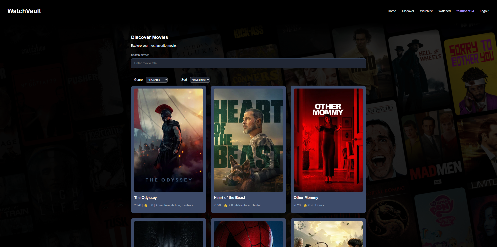
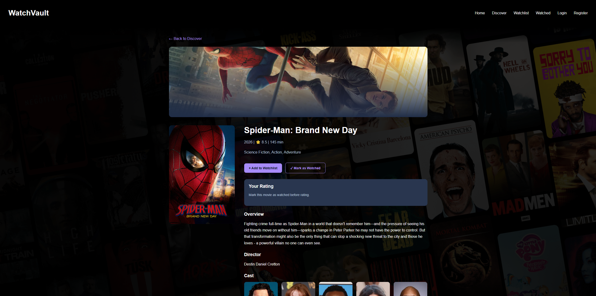
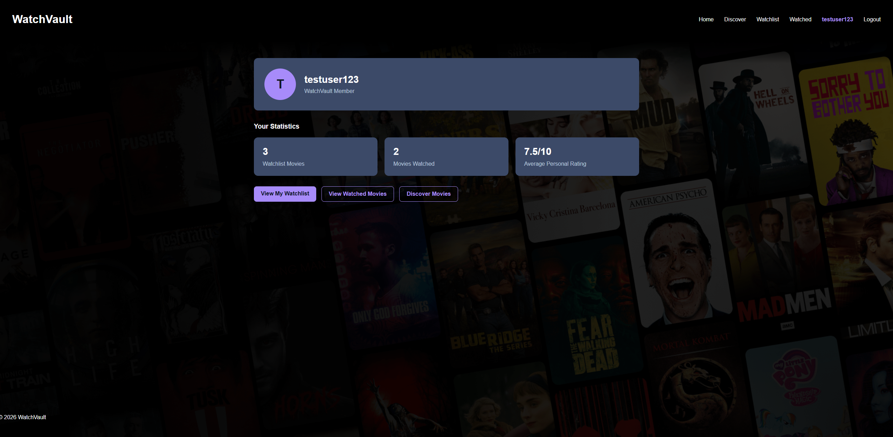

# WatchVault 

**A full-stack movie discovery and personal tracking web application.**

> **Project status: Active development / portfolio project.** WatchVault is deployed on Railway and is available as a live demo. The project is under active development.

## Live Demo

**[Try WatchVault](https://watchvault-app.up.railway.app)**

WatchVault is deployed on Railway and is available as a live portfolio demonstration.

## Features

- **Movie discovery** — browse popular movies from [The Movie Database (TMDB)](https://www.themoviedb.org/) with pagination.
- **Search, filter & sort** — filter the currently loaded movies by title and genre; sort by release year or title.
- **Movie details** — posters, backdrops, synopses, runtime, genres, directors, and cast.
- **User accounts** — registration, sign-in, sign-out, password hashing, and persistent sessions.
- **Personal watchlist** — add and remove movies, with data associated with each signed-in user.
- **Watched movies** — track completed movies and browse them on a dedicated page.
- **Personal ratings** — rate watched movies from 1 to 10, update or remove ratings.
- **Profile statistics** — watchlist count, watched count, and average personal rating.

## Tech stack

| Layer | Technologies |
| --- | --- |
| Frontend | HTML5, CSS3, vanilla JavaScript |
| Backend | Node.js, Express |
| Database | SQLite (built-in `node:sqlite`) |
| Authentication | Node.js `crypto` / scrypt, server-side sessions, HttpOnly cookies |
| Movie data | TMDB API |
| Development | Git, GitHub, VS Code |

The frontend communicates with the Express API. The backend requests movie metadata from TMDB and stores account-specific data in SQLite. **The TMDB API token is kept server-side** rather than in frontend JavaScript.

## Screenshots

### Movie Discovery


### Movie Details


### User Profile


## Run locally

### Requirements

- [Node.js 24](https://nodejs.org/) or newer (project currently uses Node.js 24 and its built-in SQLite module)
- npm
- A free **TMDB API Read Access Token** from [TMDB](https://www.themoviedb.org/settings/api)

### 1. Clone

```bash
git clone https://github.com/cyenara/WatchVault.git
cd WatchVault
```

### 2. Configure the backend

Create `backend/.env` using `backend/.env.example` as a template. Add your own TMDB API Read Access Token:

```env
TMDB_READ_TOKEN=your_tmdb_api_read_access_token
```

Never commit a real `.env` file or API token.

### 3. Install dependencies and start the API

```bash
cd backend
npm install
node --env-file=.env server.js
```

The API runs at **http://localhost:3001**. To confirm it is running, open **http://localhost:3001/api/health**.

On Windows PowerShell, if `npm` is blocked by execution policy, use `npm.cmd install`.


### 4. Open WatchVault

Once the backend server is running, open:

**http://localhost:3001**

The Express server serves both the frontend and backend, so no separate frontend server is required.

The application uses relative API routes (`/api`), allowing it to work both locally and in production.

Register a new local test account to try the watchlist, watched movies, personal ratings, and profile statistics.

The SQLite database is created automatically in `backend/data/watchvault.db`.


## Movie data attribution

Movie information and poster/backdrop images are provided by [The Movie Database (TMDB)](https://www.themoviedb.org/).

**This product uses the TMDB API but is not endorsed or certified by TMDB.**
